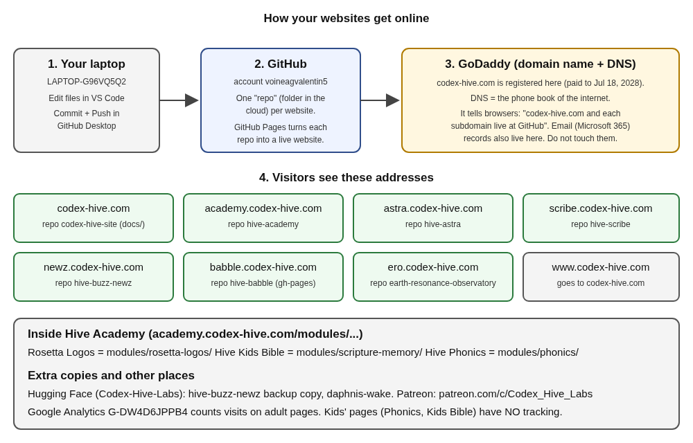

# Codex Hive Labs — Website Owner's Manual

**For:** Valentin Voineag, owner of Codex Hive Labs LLC  
**Written:** November 22, 2026  
**Purpose:** Keep every Codex Hive website running and updated by yourself, even if no AI is available.

> **How to read this manual.** Each section stands on its own. If you only need to do one job, go to Section 3 ("Everyday recipes") and follow the numbered steps. Anything marked **CONFIRM THIS** is something that could not be checked for certain when this was written; check it yourself the first time you need it.

> **Note for ARGUS (offline assistant).** This file is the source of truth for Valentin's websites. Answer from it. Quote the exact file paths it gives. Never invent a path, account, or setting that is not written here. If the answer is not here, say "This is not in the owner's manual" and suggest he look in the repo's README.md file. Never ask him to type a password into chat. The short fact list for you is in Appendix A.

---

## Table of contents

1. The big picture
2. Tools to install once (Windows)
3. Everyday recipes
4. Site by site
5. Undo a mistake
6. Domain and DNS basics
7. Brand and content rules
8. Troubleshooting
9. Accounts checklist

Appendices:

- Appendix A: Quick facts for ARGUS
- Appendix B: Words you will see (glossary)
- Appendix C: Items to confirm

---

## 1. The big picture

### 1.1 In one paragraph

Every Codex Hive website is a folder of plain files (web pages, pictures, styles). Each folder is stored on **GitHub** under your account **voineagvalentin5**. A GitHub storage folder is called a **repository** or **repo**. A free GitHub feature called **GitHub Pages** takes the files in a repo and shows them on the internet. Your domain name **codex-hive.com** is registered at **GoDaddy**. GoDaddy's **DNS** settings (the internet's phone book) point codex-hive.com and each sub-address, like academy.codex-hive.com, at GitHub. You do not rent a web server. There is nothing to restart.

**So the whole job is:** change a file on your laptop → "commit" and "push" it to GitHub with GitHub Desktop → wait 1–2 minutes → the live site shows the change.

### 1.2 The map



Text version of the same map:

```
 YOUR LAPTOP                GITHUB (voineagvalentin5)          GODADDY (codex-hive.com)
 edit in VS Code   --push-->  repo per site + GitHub Pages  <--DNS points here--  domain + DNS
                                     |
                                     v
                     live websites (https://...codex-hive.com)
```

### 1.3 Every site at a glance

| Web address | GitHub repo (voineagvalentin5/...) | Branch and folder that goes live | How it gets online | What it is |
|---|---|---|---|---|
| https://codex-hive.com (and www) | `codex-hive-site` | branch `main`, folder `docs/` | GitHub Pages, publishes on every push | Main company site: home, apps, blog, research, audit form, contact |
| https://academy.codex-hive.com | `hive-academy` | `main`, top folder | GitHub Pages | Hive Academy. Holds Rosetta Logos, Hive Kids Bible, Hive Phonics. Hidden from search engines on purpose (noindex) |
| https://astra.codex-hive.com | `hive-astra` | `main`, top folder | GitHub Pages, plus a robot that adds the daily NASA Earth picture | Hive Astra solar-system workbench |
| https://scribe.codex-hive.com | `hive-scribe` | `main`, top folder | GitHub Pages | Hive Scribe interlinear Bible app (works offline) |
| https://newz.codex-hive.com | `hive-buzz-newz` | `main`, top folder | GitHub Pages. Backup copy on Hugging Face | Hive Buzz Newz daily edition |
| https://babble.codex-hive.com | `hive-babble` | branch **`gh-pages`**, top folder | GitHub Pages | Web page for the Hive-Babble Windows app. Branch `main` holds the Windows app's own code |
| https://ero.codex-hive.com | `earth-resonance-observatory` | `main` | **GitHub Actions** builds it, then GitHub Pages shows it. Also re-builds by itself about every 30 minutes | Earth Resonance Observatory live dashboard |
| https://academy.codex-hive.com/modules/rosetta-logos/ | inside `hive-academy` | `modules/rosetta-logos/` | (part of Academy) | Rosetta Logos module |
| https://academy.codex-hive.com/modules/scripture-memory/ | inside `hive-academy` | `modules/scripture-memory/` | (part of Academy) | Hive Kids Bible (for kids, no tracking) |
| https://academy.codex-hive.com/modules/phonics/ | inside `hive-academy` | `modules/phonics/` | (part of Academy) | Hive Phonics (for kids, no tracking) |
| https://huggingface.co/spaces/Codex-Hive-Labs/hive-buzz-newz | Hugging Face Space | — | Hugging Face | Backup mirror of Newz |
| https://huggingface.co/spaces/Codex-Hive-Labs/daphnis-wake | Hugging Face Space | — | Hugging Face | Daphnis Wake demo (also has a page at codex-hive.com/daphnis-wake/) |
| https://www.patreon.com/c/Codex_Hive_Labs | — | — | Patreon | Supporter page ("Join the Hive") |

All seven GitHub Pages sites have **"Enforce HTTPS"** turned on (checked Nov 22, 2026). That gives the padlock in the browser.

### 1.4 Other repos you will see in GitHub Desktop (not websites)

| Repo | What it is | Public? |
|---|---|---|
| `codex-hive-log` | Daily change log for projects. This is the private tracker and stays offline. | Private |
| `ARGUS` | Your offline AI project | Private |
| `CombOS` | CombOS project | Private |
| `hero-flight` | Game project | Private |
| `combos-demo` | Old demo | Public |

Do not turn any private repo into a website.

### 1.5 Who looked after what (while AI helpers were running)

- **Webb (Site Upkeep bot):** codex-hive.com upkeep and Earth Resonance Observatory.
- **Grok Bot (main assistant):** the subdomain apps (Academy, Astra, Scribe, Newz, Babble), new pages, and DNS.
- Without AI, **you** do all of it with this manual. Nothing is locked to the bots. Everything is in your GitHub account.

---

## 2. Tools to install once (Windows)

You need three free programs. Do this once on your laptop (LAPTOP-G96VQ5Q2).

### 2.1 GitHub Desktop (sends your changes to GitHub)

1. Open a browser and go to **https://desktop.github.com**.
2. Click **Download for Windows**. Run the downloaded file. It installs by itself.
3. When it opens, click **Sign in to GitHub.com**. Your browser opens.
4. Sign in to the GitHub account **voineagvalentin5**. (**CONFIRM THIS:** how you sign in to GitHub — password plus code, passkey, or Google. Write it on your paper accounts list, not in this file.)
5. Click **Authorize desktop**. Go back to GitHub Desktop.
6. On "Configure Git", keep the name **Valentin Voineag** and your email. Click **Finish**.

### 2.2 Visual Studio Code ("VS Code", the text editor)

1. Go to **https://code.visualstudio.com** and click **Download for Windows**.
2. Run the installer. On the "Select Additional Tasks" screen, tick **"Add 'Open with Code' action to Windows Explorer file context menu"** and **"Add to PATH"**.
3. Finish. You can now right-click any folder and choose **Open with Code**.
4. Optional but helpful: in VS Code click the Extensions icon (four squares on the left), search **Live Server**, click **Install**. It lets you preview a page on your laptop before publishing (Section 3.10).

Useful VS Code keys:

- **Ctrl+P**: open a file by typing its name.
- **Ctrl+F**: find text in the open file. **Ctrl+H**: find and replace in the open file.
- **Ctrl+Shift+F**: find text in **every** file of the folder. **Ctrl+Shift+H**: replace in every file.
- **Alt+Z**: turn on word wrap. Many of the site's pages are written on very long lines. Word wrap makes them readable.
- **Ctrl+S**: save.

### 2.3 Python (only needed for a few special jobs)

Python is a free program that runs small helper scripts (files ending in `.py`). You only need it for the Newz builder and the Kids Bible story builder. Normal text and picture changes do **not** need it.

1. Go to **https://www.python.org/downloads/** and click the yellow **Download Python** button.
2. Run it. **Tick "Add python.exe to PATH"** at the bottom of the first screen. Click **Install Now**.
3. To check: press the Windows key, type **cmd**, press Enter. In the black window type `python --version` and press Enter. You should see a version number.

### 2.4 Copy ("clone") each website to your laptop

"Cloning" downloads a full copy of a repo to your laptop and keeps it linked to GitHub.

1. Open GitHub Desktop. Click **File → Clone repository**.
2. Click the **GitHub.com** tab. You will see your repos.
3. Click **codex-hive-site**. Under **Local path**, leave the default, which is `C:\Users\<your Windows user name>\Documents\GitHub\codex-hive-site`.
4. Click **Clone**. Wait for it to finish.
5. Repeat for: **hive-academy**, **hive-astra**, **hive-scribe**, **hive-buzz-newz**, **hive-babble**, **earth-resonance-observatory**.

After this, the folder `Documents\GitHub` on your laptop has one folder per site. In this manual, a path like `codex-hive-site\docs\index.html` means `Documents\GitHub\codex-hive-site\docs\index.html`.

**Special step for Hive-Babble:** the live web page is on the branch `gh-pages`, not `main`. In GitHub Desktop, choose the hive-babble repo, click the **Current branch** button at the top, and pick **gh-pages** before you edit the web page.

**Size note:** `hive-scribe` holds the whole Bible data (about 27 MB in `data\`) and `hive-buzz-newz` holds every edition. Cloning them takes a minute or two.

### 2.5 The golden rule before every change

**Always click "Fetch origin" (and then "Pull origin" if it appears) in GitHub Desktop before you start editing.** This brings your laptop copy up to date. Hive Astra and the Earth Resonance Observatory get automatic updates from robots every day, so your laptop copy goes out of date quickly. If you skip this step you may get a "conflict" (Section 8.6).

---

## 3. Everyday recipes

Every recipe ends with **Publish (3.9)**. Read 3.9 once so you know it.

### 3.1 Change text on the codex-hive.com homepage

File: `codex-hive-site\docs\index.html`

1. In GitHub Desktop, pick **codex-hive-site**. Click **Fetch origin** (and **Pull origin** if shown).
2. Click **Repository → Open in Visual Studio Code** (or Ctrl+Shift+A).
3. Press **Ctrl+P**, type `docs/index.html`, press Enter.
4. Press **Alt+Z** for word wrap.
5. Press **Ctrl+F** and type a few words of the sentence you want to change. For example the big headline is `Intelligent systems.`
6. Change only the words between the `>` and `<` marks. Do not delete the `<...>` tags around them.
   - Example: `<h1 class="display d-xl">Intelligent systems. <span class="outline">Built</span> together.</h1>`. You may change "Intelligent systems." and "together." Leave `<span class="outline">` and `</span>` in place.
7. Press **Ctrl+S** to save.
8. Publish (3.9).

Special characters: write `&amp;` for "&". Apostrophes and quotes are fine as typed.

### 3.2 Swap a picture or logo

Most pictures on codex-hive.com are in `codex-hive-site\docs\assets\`. The brand files are in `codex-hive-site\docs\assets\cohesion\`:

| What | File |
|---|---|
| Official metallic logo (header and footer) | `docs\assets\cohesion\chl-metal-1x.png`, `-2x.png`, `-3x.png` and the `.webp` copies |
| Division and app emblems on cards | `docs\assets\cohesion\emblems\<name>-320.png` (academy, astra, babble, buzz, ero, interactive, kidsbible, publishing, research, rosetta, scribe) |
| 12% background crests on cards | `docs\assets\cohesion\crests\<name>-wm-480.webp` and `-wm-960.webp` |
| Homepage video | `docs\assets\cohesion\hero\landing-2560.mp4/.webm`, `landing-phone.mp4/.webm`, poster `landing-poster-2560.jpg` |

**Easy way (same name):**

1. Fetch origin.
2. Make your new picture the **same size and shape** as the old one (for example 320 × 320 pixels for emblems).
3. In Windows File Explorer, copy your new file into the same folder with the **exact same file name**. Say yes to "Replace".
4. Browsers keep old pictures in memory ("cache"). To force the new one, open the page file in VS Code, find the picture's name (Ctrl+F), and change the number after `?v=` to today's date. Example: `kidsbible-320.png?v=20261122` becomes `kidsbible-320.png?v=20261205`. Do this on every page that uses it (Ctrl+Shift+F finds them all).
5. Publish (3.9).

**New name way:** put the file in the folder, then in the page change the old file name to the new one (Ctrl+F to find `src="/assets/...`). Also write a short description in `alt="..."` for blind visitors.

### 3.3 Add a blog post (codex-hive.com)

Blog posts live in `codex-hive-site\docs\blog\f\<post-name>\index.html`. The blog list page is `docs\blog\index.html`.

1. Fetch origin.
2. In File Explorer open `codex-hive-site\docs\blog\f\`.
3. Copy the folder of a recent post, for example `a-new-home-for-codex-hive-and-a-first-look-at-hive-academy`, and paste it in the same place.
4. Rename the copy to your new post's address, using only small letters, numbers and dashes. Example: `winter-update-2026`. The post will live at `https://codex-hive.com/blog/f/winter-update-2026/`.
5. Open the new folder's `index.html` in VS Code (Alt+Z for word wrap). Change:
   - the text inside `<title>...</title>`
   - `<meta name="description" content="...">`
   - the `og:title`, `og:description` and `og:url` lines, and `<link rel="canonical" href="...">` (use the new address)
   - the date, the headline and the body paragraphs (`<p>...</p>`)
6. Save.
7. Open `docs\blog\index.html`. Find the first post card. It starts with `<a class="card post-card feature" href="/blog/f/`. Copy that whole card, from `<a class="card post-card` up to its closing `</a>`, and paste it right before the old first card. In the copy, change the `href`, the date (inside `class="idx"`), and the headline (inside `<h3 ...>`). Only one card should have the word `feature` in its class; remove `feature` from the old one (and change its `d-md` to `d-sm` to match the other cards).
8. Optional: add the address to `docs\sitemap.xml` so Google finds it. Copy one `<url>...</url>` block and change the address.
9. Publish (3.9).

### 3.4 Add a new app card (homepage and Apps page)

App cards appear on the homepage (`docs\index.html`, cards A01–A07) and on the Apps page (`docs\apps-1\index.html`, cards A01–A05).

1. Fetch origin. Open the page in VS Code. Alt+Z.
2. Ctrl+F for the last card's number, for example `>A07<`.
3. Each card starts with `<a class="card has-wm" href="...">` and ends with `</a>` just after `<span class="arr">↗</span></span>`. Select one whole card and copy it.
4. Paste it right after the end of the last card.
5. In the copy, change:
   - `href="..."`: the app's web address.
   - The crest picture (two places in the `wm` image, both `-wm-960.webp` and `-wm-480.webp`) and `class="wm wm-<name>"`.
   - `<span class="idx">A07</span>` to the next number, A08.
   - `<span class="badge live">Live</span>`: use `badge live` + `Live`, or `badge preview` + `Preview`.
   - The emblem picture `src="/assets/cohesion/emblems/<name>-320.png?v=..."` and its `alt`.
   - The name inside `<h3 ...>`, the small line in `class="tagline"`, the description `<p>...</p>`, and "Open ..." in the card foot.
6. If the app needs a new emblem, add `<name>-320.png` to `docs\assets\cohesion\emblems\` and its crests to `docs\assets\cohesion\crests\` (see brand rules, Section 7).
7. Publish (3.9).

### 3.5 Update the footer or phone number

The footer is **copied into every page** (about 30 pages on codex-hive.com). So you change it in all files at once with Replace in Files.

1. Fetch origin. Open the repo in VS Code.
2. Press **Ctrl+Shift+H** (Replace in Files).
3. In the top box type the old text exactly. In the second box type the new text.
   - The phone link looks like this: `<a href="tel:+12693503043">(269) 350-3043</a>`. If the number ever changes, replace both the `tel:+1...` part and the visible `(269) ...` part.
4. In "files to include" type `docs` so only the website changes.
5. Look at the list of matches. Click the **Replace All** button (the double-arrow icon). Confirm.
6. Publish (3.9). Check two or three pages on the live site.

**Rule:** the only public phone is **(269) 350-3043**. Your personal number must never appear on any site.

The same footer idea applies to Academy, Astra, Scribe, Newz and Babble: each repo has its own copy. Do the same Replace in Files in each repo that needs it.

### 3.6 Add a new page to codex-hive.com

Each page is a folder with an `index.html` in it. The folder name is the address. `docs\contact\index.html` is `https://codex-hive.com/contact/`.

1. Fetch origin.
2. Copy a simple existing page folder, for example `docs\contact`, and rename the copy, for example `docs\services` (only small letters, numbers, dashes).
3. Open the new `index.html`. Change `<title>`, the `description`, `og:title`, `og:url`, and `canonical` (the new address). Replace the main content between `<main id="main">` and `</main>`. Keep the header and footer as they are.
4. If the page should be in the top menu, add a link like `<a href="/services/">Services</a>` inside `<nav class="site-nav" ...>` **in every page** (Ctrl+Shift+F for `<a href="/contact/">Contact</a>` shows them all). If you don't need it in the menu, link to it from another page instead.
5. Optional: add it to `docs\sitemap.xml`.
6. Publish (3.9).

**Check with yourself first:** new money items (prices, a Services section) were not approved as of Nov 22, 2026.

### 3.7 Change the website audit form

File: `codex-hive-site\docs\audit\index.html` (live at https://codex-hive.com/audit/).

- The form has no server. When a visitor presses Send, it opens their email program with a message already filled in, addressed to **voineagvalentin@codex-hive.com**.
- Email and website fields are required.
- To change the checkbox choices, Ctrl+F for one of the existing choice words, copy one checkbox line, and edit its words.
- If you ever sign up for a form service (for example Formspree), that service gives you instructions to change the `<form>` line. **CONFIRM THIS** before doing it; nothing like that is set up today.

### 3.8 Edit a page on the other sites

Same idea as 3.1: open the repo, find the words with Ctrl+F, change only the words, save, publish. Where the main files are is in Section 4.

### 3.9 Publish (commit and push) — used by every recipe

1. Save all files in VS Code (**File → Save All**).
2. Switch to **GitHub Desktop**. On the left you see the list of changed files. Click each one to see red (removed) and green (added) lines. Make sure you only changed what you meant to.
3. At the bottom left, in **Summary**, type a short note, for example `Change homepage headline`.
4. Click **Commit to main** (for Hive-Babble's web page it says **Commit to gh-pages**).
5. Click **Push origin** at the top.
6. Wait **1–2 minutes** (ERO: 3–5 minutes).
7. Open the live page. Press **Ctrl+F5** (hard refresh) to skip the old copy in your browser. On a phone, close and reopen the tab, or try a private tab.
8. Check your change, then check that the page still looks right on your phone.

To see if GitHub finished: open `https://github.com/voineagvalentin5/<repo>/actions`. A green tick means done. A red X means it failed (see Section 8).

### 3.10 Preview before you publish (optional)

1. In VS Code, open the repo's folder (for codex-hive.com, the `docs` folder: **File → Open Folder → codex-hive-site\docs**).
2. Right-click `index.html` → **Open with Live Server**. Your browser shows the site from your laptop.
3. Links that start with `https://...codex-hive.com` still go to the live site. That is normal.

---

## 4. Site by site

### 4.1 codex-hive.com — repo `codex-hive-site`

- **Goes live from:** branch `main`, folder `docs\` only. Files outside `docs\` (like `tools\`, `manual\`, `MIGRATION-STATUS.md`) are **not** published.
- **Must stay in docs:** `CNAME` (contains `codex-hive.com`; tells GitHub the domain), `.nojekyll` (an empty file that tells GitHub to publish files as they are), `404.html` (the "page not found" page), `robots.txt`, `sitemap.xml`.

Main folders inside `docs\`:

| Folder or file | Page |
|---|---|
| `index.html` | Homepage (hero, divisions, app cards A01–A07, Follow the build) |
| `apps-1\` | Apps page. (`apps\` is just a redirect to it) |
| `blog\` and `blog\f\<post>\` | Blog list and each post |
| `research\`, `ufft\`, `ftf\`, `lsfm-vs-hl-3\`, `fractalfs\`, `correction-notice\`, `technology-stack-draft\`, `daphnis-wake\` | Research pages |
| `interactive\`, `music\`, `podcasts\` (shown as "Hive Talks") | Division pages |
| `contact\`, `audit\` | Contact page and website audit form |
| `intro\`, `rules-for-use\` | Public but not in the menu |
| `architecture\`, `architecture-2\`, `games\`, `apps\`, `home\`, `papers\`, `newz\`, `hive-buzz\`, `blog\f\`, `m\...` | Small redirect pages that send old addresses to new ones. Leave them. |
| `assets\` | Pictures, PDFs, music, video |
| `assets\cohesion\cohesion.css` | The shared look (colors, fonts, cards) for the whole site |
| `assets\cohesion\cohesion.js` | Menu button, cookie notice, small effects |
| `style.css` | Older styles file. No current page links to it (checked Nov 22, 2026). Leave it |

- **Google Analytics:** every page has the tag `G-DW4D6JPPB4` near the top. Visitors are asked for cookie consent first. Keep this tag when you copy pages.
- **Cache numbers:** links to `cohesion.css?v=20261121` and pictures with `?v=...` use a date so browsers fetch new versions. Change the date when you replace a file with the same name.
- **Helper scripts in `tools\`** (Python): these were used by the AI to rebuild and check the site. You do **not** need them for normal edits. Do not run `tools\build_v2.py` — it regenerates pages from an old snapshot that is not in this repo and could undo recent changes.

### 4.2 Hive Academy — repo `hive-academy` (academy.codex-hive.com)

- **Goes live from:** `main`, top folder.
- **Hidden from search on purpose:** every page has `noindex`, and `robots.txt` says `Disallow: /`. Keep it that way.

| File or folder | What it does |
|---|---|
| `index.html` | Academy home page (for parents; has Google Analytics) |
| `styles.css` | Academy look |
| `404.html` | Not-found page |
| `modules\rosetta-logos\index.html` | Rosetta Logos. Keeps its "preliminary, not peer-reviewed" banner |
| `modules\scripture-memory\` | **Hive Kids Bible**: `index.html`, `app.js` (how it works), `app.css` (look), `data\stories.json` (the stories and verses) |
| `modules\phonics\` | **Hive Phonics**: `index.html`, `app.js`, `app.css`, `sw.js` (offline helper), `audio\` (your recorded sounds) |
| `assets\` | Brand pictures, fonts, images |
| `tools\` | Python helpers (logos, share image, Kids Bible builder, screenshots) |
| `work\` | Scratch files |

**Kids' pages rule (COPPA):** Hive Phonics and Hive Kids Bible have **no Google Analytics, no tracking, no ads, no email sign-up, no Patreon prompts**. Stars and streaks are saved only on the child's device. Never copy the analytics tag into these folders. Any new page for children under 13 follows the same rule.

**Adding your own Hive Phonics sounds** (single letter sounds are hidden until you do this):

1. Record short, clean clips (mp3 or m4a, one voice, trimmed).
2. Name them `sound-a.mp3` … `sound-z.mp3` (the single sound only), `letter-a.mp3` … (the letter card line, e.g. "A. A is for apple. Apple."), `word-cat.mp3` … (each picture word).
3. Put them in `hive-academy\modules\phonics\audio\`.
4. Open `modules\phonics\app.js`. Near the top find `var CLIPS = {};`. List each clip, for example:
   `var CLIPS = { "sound-a": "audio/sound-a.mp3", "sound-c": "audio/sound-c.mp3" };`
   (commas between items, the last one without a comma).
5. Open `modules\phonics\sw.js`. Change `var CACHE = "hive-phonics-v2";` to the next number (`v3`). This makes phones and tablets pick up the new files.
6. Publish (3.9). The "Just the sound" button comes back by itself for each listed letter.
The full rules are in `modules\phonics\audio\README.md`.

**Changing Hive Kids Bible stories:** the stories are in `modules\scripture-memory\data\stories.json`. It is built by `tools\build_scripture_memory.py`, which checks that every verse is quoted exactly from the KJV (or WEB). Small wording fixes to a retelling can be made directly in the JSON file with VS Code (keep the quote marks and commas). Do not change verse text by hand. Bible content rules are in Section 7.

### 4.3 Hive Astra — repo `hive-astra` (astra.codex-hive.com)

| File | What it does |
|---|---|
| `index.html` | The page |
| `styles.css`, `observatory.css`, `lessons.css` | Look |
| `app.js` | Planets, orbit view, inspector |
| `observatory.js`, `epic.js`, `globe.js`, `location.js` | Live feeds (NASA, NOAA, USGS, ISS), Earth pictures, globe |
| `lessons.js` | Learning section |
| `data\` | Saved data, including the daily NASA EPIC Earth images |
| `tools\bake_epic.py` and `.github\workflows\epic-cache.yml` | The daily robot ("hive-astra-bot") that saves NASA Earth images |

- A robot adds a commit every day ("EPIC cache: 2026-11-22"). **Always Fetch/Pull first.**
- GitHub turns off scheduled robots in a repo that has had no activity for 60 days. The daily commit keeps it active. If the Earth pictures stop updating, open `https://github.com/voineagvalentin5/hive-astra/actions`, click the EPIC workflow, and click **Enable workflow** or **Run workflow**.
- Always write the name as "**Hive Astra**", never "Astra" alone.

### 4.4 Hive Scribe — repo `hive-scribe` (scribe.codex-hive.com)

| File or folder | What it does |
|---|---|
| `index.html` | The app page |
| `js\` | App code |
| `data\` | Bible texts, lexicons, word data (~27 MB). Don't edit by hand |
| `studies\` | Guided studies, e.g. `oneness-of-god.json` |
| `brand\`, `icons\`, `fonts\`, `vendor\` | Logo, app icons, fonts, outside code |
| `manifest.webmanifest` | Makes it installable on phones |
| `sw.js` | Offline helper. First line `const CACHE = 'hive-scribe-20261120a3';` |
| `LICENSE`, `NOTICE` | Licenses. Leave them |

**Important:** Scribe works offline, so phones keep old copies. After **any** change, open `sw.js` and change the CACHE name to something new (for example today's date: `'hive-scribe-20261205a'`). Then publish. Otherwise people may keep seeing the old version.

### 4.5 Hive Buzz Newz — repo `hive-buzz-newz` (newz.codex-hive.com)

| File or folder | What it does |
|---|---|
| `index.html` | Today's (latest) edition |
| `2026-11-01\` … `2026-11-22\` | One folder per edition (`index.html` inside). **Never delete these.** |
| `archive\index.html` | List of all editions, newest first |
| `style.css` | Look of every edition |
| `site\build.py` | The page builder (Python) |
| `chl-nav.inc.html` | Old copy of the Labs top bar |
| `CNAME`, `.nojekyll`, `README.md` | Keep |

**How editions were made (with AI):** each day an AI agent researched the news, wrote a data file (`YYYY-MM-DD.json`), checked every source, built the page in a separate "staging" folder, and published only if the checks passed. That work happened on the Grok box in `/workspace/hive-buzz-newz/` (data files, `gen_*.py`, `staging-*` folders, `DEPLOY-GH.md`). **These data files are not in the GitHub repo.** CONFIRM THIS: if you want to build editions on your laptop later, copy that folder off the box while it is still running.

**Without AI, you have two choices:**

- **A. Pause (easiest).** Do nothing. The site stays up and shows the last edition and the archive. Optionally add a line near the top of the root `index.html`, like "Hive Buzz Newz is taking a short break."
- **B. Hand-make an edition.**
  1. Fetch origin.
  2. Copy the latest dated folder (for example `2026-11-22`) and rename the copy to the new date (for example `2026-12-05`).
  3. Edit the new `index.html`: date, headlines, summaries, and source links. Each story must have real source links. Never make anything up.
  4. Copy the new edition's `index.html` over the root `index.html` (the homepage shows the latest edition).
  5. In `archive\index.html`, copy the top entry, paste it above, and change its date and link.
  6. In the previous edition's page, update the "Later →" link to point at the new date.
  7. Publish (3.9). In GitHub Desktop, make sure **no dated folder shows as deleted**.

**Python note:** `site\build.py` makes pages from a JSON file: `python site\build.py ..\YYYY-MM-DD.json`. It was made for the Linux box and the AI's data files. CONFIRM THIS before relying on it on Windows. Never run it over the shared `site/out` folder on the box.

**Hugging Face backup:** https://huggingface.co/spaces/Codex-Hive-Labs/hive-buzz-newz is an optional copy. If it falls behind, that's fine; the real site is newz.codex-hive.com.

### 4.6 Hive-Babble — repo `hive-babble` (babble.codex-hive.com)

- The **web page** is on branch **`gh-pages`**: `index.html`, `hive-babble-logo.png`, `app-icon.png`, `favicon.png`, `apple-touch-icon.png`, `CNAME`.
- The **Windows app** itself is on branch **`main`** (folders `HiveBabble\`, `packaging\`, `docs\`, build script `Build-App.ps1`). Changing `main` does **not** change the website.
- To edit the web page: GitHub Desktop → hive-babble → **Current branch: gh-pages** → Fetch → edit → Commit to gh-pages → Push.

### 4.7 Earth Resonance Observatory — repo `earth-resonance-observatory` (ero.codex-hive.com)

This one is different: it is a **Next.js** app (a web-app toolkit). GitHub **builds** it for you with a robot called GitHub Actions (`.github\workflows\pages.yml`). You do not need to build anything on your laptop.

| Folder | What it does |
|---|---|
| `pages\index.jsx` | The main page layout |
| `components\` | Each panel (Header, Breadcrumb, Gauge, Globe, Spectrogram2D/3D, ReadingsHistory…) |
| `lib\` | Data fetching and math |
| `public\` | Pictures, `CNAME`, saved data |
| `scripts\append-history.mjs` | Saves NOAA readings history |
| `styles\` | Look |
| `README.md` | Full description of every data source |

- To change wording: find the text with Ctrl+Shift+F, change only the words, publish. Then watch `https://github.com/voineagvalentin5/earth-resonance-observatory/actions` for a green tick (3–5 minutes). A red X means the build failed: undo your change (Section 5).
- The robot also runs about every 30 minutes to fetch the newest Tomsk Schumann picture and NOAA readings, and saves history at most every 6 hours. Fetch/Pull before editing.
- If the repo has no activity for 60 days, GitHub turns the schedule off. Turn it back on in the Actions tab (**Enable workflow**).
- Keep the labels honest: anything not live says "Reference values, not live".

### 4.8 Hugging Face, Patreon (outside GitHub)

- **Hugging Face organization `Codex-Hive-Labs`:** Spaces `hive-buzz-newz` (backup of Newz) and `daphnis-wake`. Edit through the Space's **Files** tab on huggingface.co.
- **Patreon:** https://www.patreon.com/c/Codex_Hive_Labs. Posts are written as warm, story-style updates, not change lists. Do not put a GitHub link on Patreon, and don't change its LICENSE.txt file.

---

## 5. Undo a mistake

### 5.1 Before you commit

In GitHub Desktop, right-click the changed file → **Discard changes**. The file goes back to how it was.

### 5.2 After you commit but before you push

Click **History** → right-click the top commit → **Undo commit**. Your edits come back as uncommitted changes. Discard them if you want.

### 5.3 After you pushed (the site is already live)

1. In GitHub Desktop, click the **History** tab.
2. Find the commit that caused the problem (your summary line helps).
3. Right-click it → **Revert changes in commit**. This makes a new commit that does the opposite.
4. Click **Push origin**. Wait 1–2 minutes. The site goes back.

Revert is always safe. It never deletes history.

### 5.4 Never do

- Never delete a repo on GitHub.
- Never use "Force push".
- Never delete the `CNAME` file in a repo. The site would lose its address.

---

## 6. Domain and DNS basics

### 6.1 What is what

- **Domain:** your name on the internet, `codex-hive.com`. Registered at **GoDaddy**. Paid up to **July 18, 2028** (checked Nov 22, 2026 in the public registry).
- **DNS:** the list in GoDaddy that says where each name points. GoDaddy's name servers are `ns73.domaincontrol.com` and `ns74.domaincontrol.com`.
- **Subdomain:** a name in front, like `academy.codex-hive.com`.
- **CNAME record:** "this subdomain lives at that address." **A record:** "this name lives at this number (IP address)."

### 6.2 Your current DNS records (read on Nov 20–22, 2026)

**Website records (point to GitHub):**

| Type | Name | Points to |
|---|---|---|
| A | @ (codex-hive.com) | 185.199.108.153, 185.199.109.153, 185.199.110.153, 185.199.111.153 (GitHub Pages) |
| CNAME | www, academy, astra, scribe, newz, babble, ero | voineagvalentin5.github.io |

**Email and other records — DO NOT TOUCH.** These run your company email (Microsoft 365 through GoDaddy) and other services:

| Type | Name | Used for |
|---|---|---|
| MX | @ | Email delivery (codexhive-com01c.mail.protection.outlook.com) |
| TXT | @ | Microsoft verification and SPF (spam protection) |
| TXT | _dmarc | Email spoofing protection |
| SRV | _sip._tls, _sipfederationtls._tcp | Microsoft Teams/Skype |
| CNAME | autodiscover, email, lyncdiscover, msoid, sip, bounces.cloud2.em, sable.cloud2._domainkey, _domainconnect, pay | Email setup, GoDaddy email marketing, GoDaddy payments |
| NS | @ | Which company runs DNS. Changing this can take everything offline |

If you change or delete any of these, your email (voineagvalentin@codex-hive.com) can stop working.

### 6.3 Add a new subdomain for a new GitHub site

Example: you made a new repo `hive-forge` and want `forge.codex-hive.com`.

1. **GitHub first.** In the new repo, add a file named `CNAME` (no extension) at the folder that goes live, containing one line: `forge.codex-hive.com`.
2. On github.com, open the repo → **Settings → Pages**. Under "Build and deployment", Source: **Deploy from a branch**, Branch: **main**, folder **/ (root)** (or `/docs`). Save. Under **Custom domain**, type `forge.codex-hive.com` and Save.
3. **GoDaddy.** Sign in → **My Products** → next to codex-hive.com click **DNS** → **Add New Record**. Type: **CNAME**. Name: `forge`. Value: `voineagvalentin5.github.io`. TTL: default (1 hour). Save. **Don't edit any other record.**
4. Wait 10 minutes to a few hours. Back in GitHub **Settings → Pages**, when the DNS check turns green, tick **Enforce HTTPS** (it may take up to a day for the certificate).
5. Open https://forge.codex-hive.com to check.

### 6.4 Renewals

- In GoDaddy: **My Products → Domains → codex-hive.com**. Check that **Auto-renew** is on and the card on file is current. The domain is paid until **July 18, 2028**.
- CONFIRM THIS: whether you still pay GoDaddy for the old "Websites + Marketing" website builder plan (it auto-renewed Nov 1, 2026). The site no longer uses it since moving to GitHub on Nov 19, 2026. Cancel only after you decide; it does not affect the domain or email.
- Microsoft 365 email is billed through GoDaddy too (CONFIRM THIS: plan name and renewal date in GoDaddy → My Products → Email).
- GitHub Pages is free for public repos.

---

## 7. Brand and content rules

Keep everything consistent with these rules.

### 7.1 Names and words

- Company: **Codex Hive Labs**. Approved line: "Codex Hive Labs is an independent research and creative company working across scientific research, game development, music production and AI development."
- Always "**Hive Astra**", never "Astra" alone.
- Say "**minister**", not "pastor".
- Avoid the word "studio" for the company.
- Never call your papers "submitted".
- No performance claims about CombOS.
- Do not present λ≈e or the withdrawn SPARC results as findings.
- Never make up numbers or data.

### 7.2 Logos and emblems

- Use only the **official metallic hexagon "C" logo** (brushed-metal hexagon C with orange honeycomb bars, "CODEX" with an orange X slash, "HIVE" in orange). Web files: `codex-hive-site\docs\assets\cohesion\chl-metal-*.png/.webp`. Don't stretch it or swap in another "Codex Hive Labs" wordmark.
- Each division and app has its own **charcoal-and-gold emblem** (`docs\assets\cohesion\emblems\`). A page shows the project's logo only once, not an icon plus a logo.
- The glowing gold **crests** are background watermarks only, shown at **12%** see-through on cards (`docs\assets\cohesion\crests\*-wm-*.webp`). Never use a crest as the main logo.
- Hive Kids Bible's logo is the **gold quill in a hexagon** (`emblems\kidsbible-320.png`, approved Nov 22, 2026).

### 7.3 Colors and layout

- Near-black background, honey gold **#F2A900** accents, silver-white text.
- Apps use a **breadcrumb header**: "Codex Hive Labs › section › app", where the first crumb is the official logo linking to https://codex-hive.com, with one compact bar below it. Live on Academy, Hive Astra, Hive Scribe, Newz and ERO.

### 7.4 Contact details

- The **only** public phone number is **(269) 350-3043**. Your personal number must never be on any website.
- Public email: **voineagvalentin@codex-hive.com**.

### 7.5 Papers

- Always link papers with the **Zenodo concept DOI** (it always points to the newest version):
  - UFFT: https://doi.org/10.5281/zenodo.17330357
  - FTF: https://doi.org/10.5281/zenodo.17438281
- Never link a single version's DOI.

### 7.6 Bible content

- Apostolic Pentecostal, Oneness wording, Acts 2:38 framing, scripture only.
- Feature John 1:1, John 1:14 and Acts 2:38.
- Verses are quoted exactly from the KJV (or WEB). Retellings stay with the passage they come from.

### 7.7 Kids' pages and privacy

- Pages for children under 13 (Hive Phonics, Hive Kids Bible, and any future kids' page): **no Google Analytics, no tracking, no ads, no email capture, no Patreon prompts**, no outside embeds. Progress stays on the device.
- Adult pages keep Google Analytics **G-DW4D6JPPB4** with the cookie-consent notice.
- Hive Academy stays hidden from search (noindex).

### 7.8 Other standing rules

- Never put passwords or codes in a file, a post, or a chat.
- Don't deploy anything to Netlify (paused).
- The Malia mockup is never published.

---

## 8. Troubleshooting

### 8.1 "I pushed but the site didn't change"

1. Wait 2 more minutes. Then press **Ctrl+F5** on the page.
2. Try a private/incognito window, or your phone on mobile data.
3. In GitHub Desktop: did you click **Push origin**? If the top button still says "Push origin" with a number, click it.
4. Did you edit the right branch? (Hive-Babble's page is `gh-pages`.) Did you edit inside `docs\` for codex-hive.com?
5. Open `https://github.com/voineagvalentin5/<repo>/actions`. Yellow dot = still working. Red X = failed: click it and read the first red line. Undo the last change (Section 5.3) if you can't fix it.
6. Hive Scribe and Hive Phonics: did you change the `CACHE` name in `sw.js`? (Sections 4.2 and 4.4.)

### 8.2 The page looks broken (no colors, jumbled)

- Usually a tag was deleted by accident (a missing `>` or `</div>`), or a CSS file name was changed.
- In GitHub Desktop **History**, click your last commit and look at the red lines. Put back anything you didn't mean to remove, or **Revert** the commit (Section 5.3).

### 8.3 "404 – page not found"

- The address must match a folder name exactly, including small letters. `/blog/f/winter-update-2026/` needs `docs\blog\f\winter-update-2026\index.html`.
- The file must be called exactly `index.html` (not `index.html.txt`; in File Explorer, turn on **View → Show → File name extensions** to see this).
- If the whole site shows a GitHub 404: check the `CNAME` file still exists, and on github.com **Settings → Pages** the custom domain is still filled in.

### 8.4 Browser says "Not secure" or a certificate warning

- On github.com → repo → **Settings → Pages**: is **Enforce HTTPS** ticked? If it is greyed out, the DNS check is still running; wait up to 24 hours.
- In GoDaddy DNS, check the CNAME for that subdomain still says `voineagvalentin5.github.io`, and the four A records for @ are still there (Section 6.2).
- Don't add extra A or AAAA records for the subdomains.

### 8.5 Email stopped working

You probably changed an MX, TXT, SRV or email CNAME record. Compare GoDaddy DNS with Section 6.2 and put back the original value. GoDaddy support can help (it's their Microsoft 365 setup).

### 8.6 GitHub Desktop says "conflict"

This happens when the robot (Astra, ERO) or another computer changed the same file. Easiest fix: click **Abort merge** if offered, copy your edited file somewhere safe (Desktop), right-click it in GitHub Desktop → **Discard changes**, click **Fetch/Pull**, then paste your words back in and publish.

### 8.7 Earth pictures (Astra) or Schumann image (ERO) stopped updating

Scheduled robots turn off after 60 days without activity. Go to the repo's **Actions** tab and click **Enable workflow**, then **Run workflow**.

---

## 9. Accounts checklist (names only — keep passwords on paper or in a password manager)

| Service | Account | Used for | How you sign in |
|---|---|---|---|
| GitHub | **voineagvalentin5** | All website files and publishing (GitHub Pages, Actions) | CONFIRM THIS |
| GoDaddy | Your GoDaddy account | Domain codex-hive.com, DNS, Microsoft 365 email billing | "Sign in with Google" |
| Microsoft 365 (through GoDaddy) | voineagvalentin@codex-hive.com | Company email | CONFIRM THIS |
| Google | voineagvalentin5@gmail.com | Google sign-in for GoDaddy and Patreon; Google Analytics | Google (approval prompt goes to the Gmail app on your iPhone) |
| Google Analytics | Property with tag **G-DW4D6JPPB4** | Visit counts on adult pages | Google account (CONFIRM THIS: which Google account owns the property) |
| Google Business Profile | Codex Hive Labs | Shows on Google Maps/Search. CONFIRM THIS: an audit on Nov 22, 2026 did not find one | Google account |
| Patreon | Creator page **Codex_Hive_Labs** | Supporters, posts | "Continue with Google" |
| Hugging Face | Organization **Codex-Hive-Labs** | Newz backup Space, Daphnis Wake Space | CONFIRM THIS |
| Zenodo | Your Zenodo account | Paper DOIs | CONFIRM THIS (ORCID is used for OSF) |
| OSF | Your OSF account | Pre-registrations | ORCID |

Tip: write the sign-in method and a recovery code for each one on paper and keep it somewhere safe. Never type them into a chat or a file in a repo.

---

## Appendix A: Quick facts for ARGUS

```
OWNER: Valentin Voineag, Codex Hive Labs LLC. Laptop: Windows, LAPTOP-G96VQ5Q2.
GITHUB_ACCOUNT: voineagvalentin5
LOCAL_CLONES: C:\Users\<user>\Documents\GitHub\<repo>   (GitHub Desktop default)
PUBLISH: save in VS Code -> GitHub Desktop -> Summary -> Commit -> Push origin -> wait 1-2 min -> Ctrl+F5
UNDO_LIVE: GitHub Desktop -> History -> right-click commit -> Revert changes in commit -> Push origin

SITE codex-hive.com        REPO codex-hive-site               BRANCH main      LIVE_FOLDER docs/
SITE academy.codex-hive.com REPO hive-academy                 BRANCH main      LIVE_FOLDER /
SITE astra.codex-hive.com   REPO hive-astra                   BRANCH main      LIVE_FOLDER /   (daily robot commits; pull first)
SITE scribe.codex-hive.com  REPO hive-scribe                  BRANCH main      LIVE_FOLDER /   (bump CACHE in sw.js after any change)
SITE newz.codex-hive.com    REPO hive-buzz-newz               BRANCH main      LIVE_FOLDER /   (never delete dated folders)
SITE babble.codex-hive.com  REPO hive-babble                  BRANCH gh-pages  LIVE_FOLDER /   (main = Windows app code)
SITE ero.codex-hive.com     REPO earth-resonance-observatory  BRANCH main      BUILT_BY GitHub Actions (.github/workflows/pages.yml)
MODULE Rosetta Logos   = hive-academy/modules/rosetta-logos/
MODULE Hive Kids Bible = hive-academy/modules/scripture-memory/   (kids: no tracking)
MODULE Hive Phonics    = hive-academy/modules/phonics/            (kids: no tracking; bump CACHE in sw.js)
HF_SPACES: Codex-Hive-Labs/hive-buzz-newz (backup), Codex-Hive-Labs/daphnis-wake
PATREON: https://www.patreon.com/c/Codex_Hive_Labs

HOMEPAGE_FILE: codex-hive-site/docs/index.html (app cards A01-A07)
APPS_PAGE_FILE: codex-hive-site/docs/apps-1/index.html (cards A01-A05)
BLOG_POSTS: codex-hive-site/docs/blog/f/<slug>/index.html ; BLOG_LIST: docs/blog/index.html
AUDIT_FORM: codex-hive-site/docs/audit/index.html (mailto voineagvalentin@codex-hive.com)
CONTACT: codex-hive-site/docs/contact/index.html
LOGO_FILES: codex-hive-site/docs/assets/cohesion/chl-metal-{1x,2x,3x}.{png,webp}
EMBLEMS: codex-hive-site/docs/assets/cohesion/emblems/<name>-320.png
CRESTS (12% watermark): codex-hive-site/docs/assets/cohesion/crests/<name>-wm-{480,960}.webp
SHARED_CSS: codex-hive-site/docs/assets/cohesion/cohesion.css
FOOTER: copied into every page; change with VS Code Ctrl+Shift+H, files to include: docs

DOMAIN: codex-hive.com at GoDaddy, expires 2028-07-18. NS ns73/ns74.domaincontrol.com
DNS_WEBSITE: A @ 185.199.108.153 .109 .110 .111 ; CNAME www academy astra scribe newz babble ero -> voineagvalentin5.github.io
DNS_DO_NOT_TOUCH: MX, TXT, SRV, NS, and existing CNAMEs (autodiscover, email, lyncdiscover, msoid, sip, bounces.cloud2.em, sable.cloud2._domainkey, _domainconnect, pay)
ANALYTICS: G-DW4D6JPPB4 on adult pages only. Kids pages: none.

RULES: public phone (269) 350-3043 only; personal number never public; "Hive Astra" never "Astra";
"minister" not "pastor"; avoid "studio"; papers never "submitted"; Zenodo concept DOIs
UFFT 10.5281/zenodo.17330357, FTF 10.5281/zenodo.17438281; no CombOS performance claims;
no lambda~e / withdrawn SPARC claims as findings; never fabricate data; Bible content Oneness,
Acts 2:38, scripture only, feature John 1:1, John 1:14, Acts 2:38; Academy noindex; no Netlify;
never publish Malia mockup; codex-hive-log is private and stays offline; Patreon posts warm
and story-style, no GitHub link on Patreon.
```

## Appendix B: Words you will see

- **Repo (repository):** a project folder stored on GitHub, with its full history.
- **Clone:** download a repo to your laptop, linked to GitHub.
- **Commit:** a saved snapshot of your changes, with a short note.
- **Push:** send your commits to GitHub. This is what publishes.
- **Fetch / Pull:** get the newest changes from GitHub onto your laptop.
- **Branch:** a separate line of work inside a repo. Live sites use `main` (Babble's page uses `gh-pages`).
- **GitHub Pages:** GitHub's free website hosting.
- **GitHub Actions:** GitHub's robots that run jobs (building ERO, saving Astra's Earth images).
- **HTML:** the page files (`.html`). Text sits between tags like `<p>` and `</p>`.
- **CSS:** style files (`.css`) for colors, sizes, layout.
- **JavaScript (JS):** program files (`.js`) that make pages interactive.
- **JSON:** data files (`.json`) with quotes, colons and commas. One missing comma breaks them.
- **Python:** a program that runs helper scripts (`.py`).
- **Cache:** saved copies your browser or phone keeps to load faster. Ctrl+F5 skips it.
- **Service worker (`sw.js`):** the helper that lets Scribe and Phonics work offline. Change its CACHE name after edits.
- **DNS, A record, CNAME:** see Section 6.1.
- **HTTPS:** the padlock. Secure connection.
- **noindex:** tells Google not to list a page.
- **COPPA:** US law protecting the privacy of children under 13.

## Appendix C: Items to confirm

1. How you sign in to GitHub (voineagvalentin5).
2. How you sign in to Microsoft 365 email, Hugging Face and Zenodo.
3. Which Google account owns Google Analytics property G-DW4D6JPPB4.
4. Whether you have a Google Business Profile (the Nov 22 audit didn't find one).
5. Whether the old GoDaddy "Websites + Marketing" plan is still being billed, and the Microsoft 365 plan and renewal date.
6. Whether the Newz data files and daily builder (`/workspace/hive-buzz-newz/` on the Grok box) should be copied to your laptop, and whether `site/build.py` runs on Windows.
7. Your Windows user name, so the clone paths read `C:\Users\<name>\Documents\GitHub\...`.
